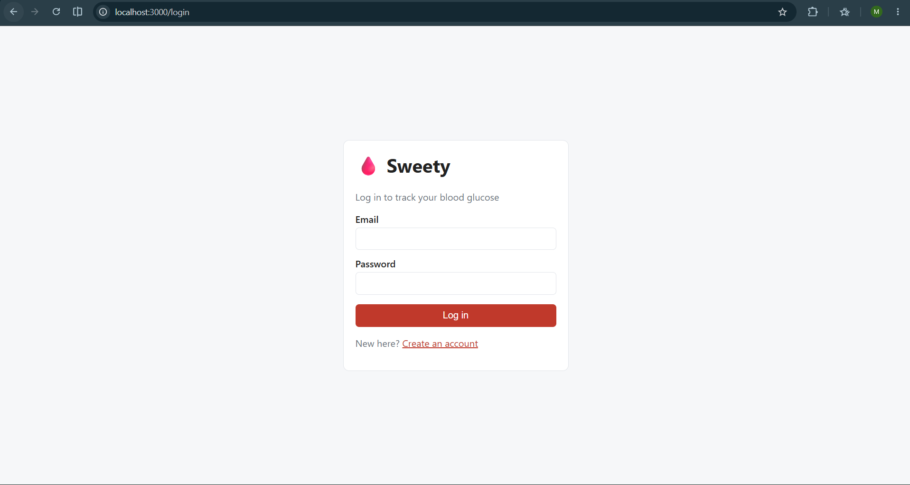
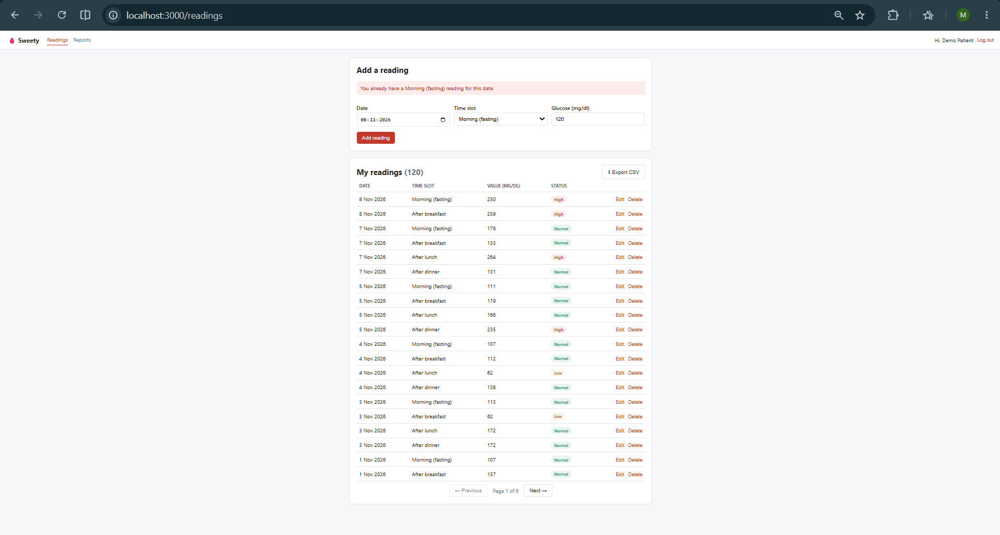
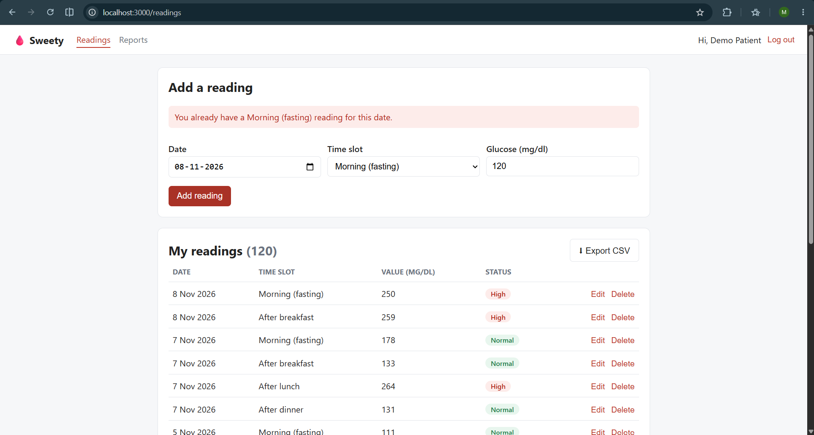
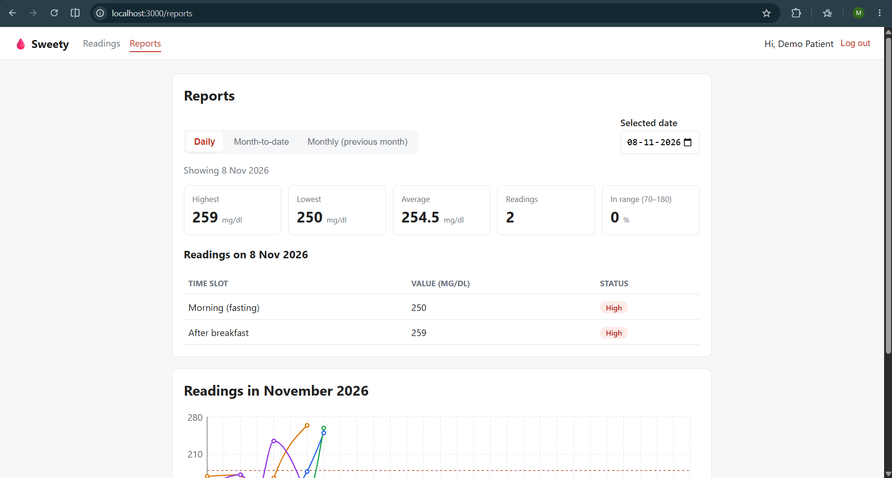
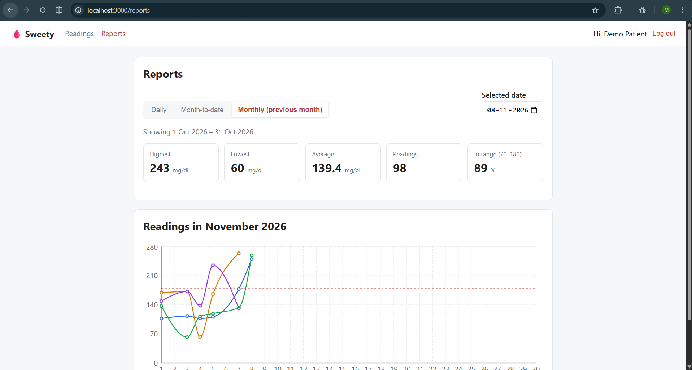
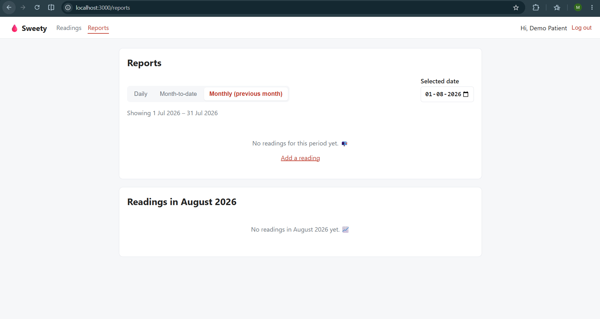
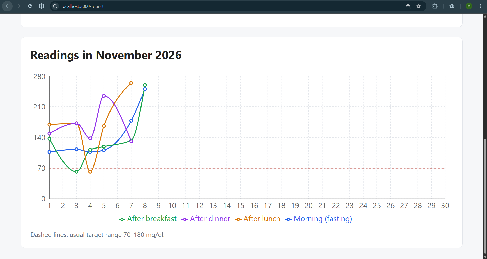

# 🩸 Sweety – Blood Glucose Tracker

Sweety is a small web app where a diabetes patient records up to 4 blood glucose readings a day and views daily, month-to-date and monthly reports.

**Stack:** Node.js + Express · PostgreSQL · React (Vite) · Jest + Supertest · Vitest + React Testing Library · Docker Compose

**Demo login (after seeding):** `demo@sweety.app` / `demo1234`

---

## Features

**Required**
- **Sign up and log in.** Passwords are hashed with bcrypt and logins use a JWT. Every query is filtered by the logged-in user, so users only ever see their own readings.
- **Add, view, edit and delete readings** (date, time slot, value in mg/dl), with all 5 validation rules shown as clear messages in the UI.
- **Reports:** daily, month-to-date and monthly (the previous month), each with highest, lowest, average (1 decimal) and count. The daily report also lists each reading with its slot. Periods with no readings show a friendly empty state.

**Bonus tasks (from the assignment)**
- Pagination on `GET /api/readings?page=1&limit=20`
- Line chart of the month's readings (Recharts), one line per slot, with the 70–180 target range marked
- `docker-compose.yml` that starts PostgreSQL, the API and the React app
- React Testing Library tests for the reading form

**Small extras**
- Low / Normal / High badge on every reading, and "% in range" on reports
- Export all readings to CSV

## Screenshots

| Login | Readings (badges, pagination, CSV export) |
|---|---|
|  |  |

| Validation error | Daily report |
|---|---|
|  |  |

| Monthly report (previous month) | Empty state |
|---|---|
|  |  |

**Monthly line chart**



---

## Getting started

There are two ways to run the app: everything in Docker (quickest), or locally for development.

### Prerequisites
- [Docker Desktop](https://www.docker.com/products/docker-desktop/), for PostgreSQL (or for the whole app)
- [Node.js](https://nodejs.org/) 20.19+ or 22+ (only needed for local development and tests)

### Option A – Run everything with Docker

```bash
git clone https://github.com/ManishGoel004/sweety.git
cd sweety
docker compose up --build -d                        # starts db + API + React app
docker compose exec server node scripts/seed.js     # optional: demo user + sample readings
```

Then open **http://localhost:3000**. The API runs on http://localhost:5000, and the database tables are created automatically when the API starts.

Stop everything with `docker compose down`. Add `-v` to also delete the database data.

### Option B – Local development

**1. Install dependencies**
```bash
cd server && npm install
cd ../client && npm install
```

**2. Set up the database**
```bash
# from the project root: start only PostgreSQL
docker compose up -d db

# create server/.env from the example (the defaults match docker-compose)
cp .env.example server/.env        # Windows PowerShell: Copy-Item .env.example server/.env

cd server
npm run migrate                    # creates the tables
npm run seed                       # demo user + ~120 sample readings
```

The Docker database also creates a second database, `sweety_test`, which the tests use. If you use your own PostgreSQL instead of Docker, create both databases (`sweety`, `sweety_test`) and update the URLs in `server/.env`.

**3. Run the server and the client** (in two terminals)
```bash
cd server && npm run dev           # API on http://localhost:5000 (restarts on changes)
cd client && npm run dev           # React app on http://localhost:5173
```

### Running the tests

The database must be running (`docker compose up -d db`).

```bash
cd server && npm test              # 59 API tests (Jest + Supertest) on the sweety_test database
cd client && npm test              # 18 frontend tests (Vitest + React Testing Library)
```

### Environment variables

All variables are listed in [`.env.example`](.env.example):

| Variable | Used by | Purpose |
|---|---|---|
| `PORT` | server | API port (default 5000) |
| `DATABASE_URL` | server | PostgreSQL connection for the app |
| `TEST_DATABASE_URL` | server | PostgreSQL connection for `npm test` |
| `JWT_SECRET` | server | Secret used to sign login tokens. **Change it outside local dev.** |
| `JWT_EXPIRES_IN` | server | How long a login lasts (default `1d`) |
| `CLIENT_ORIGIN` | server | Frontend URL allowed by CORS |
| `VITE_API_URL` | client | API base URL (optional, defaults to `http://localhost:5000/api`) |

---

## How it works

### Validation rules

The rules are checked on the server (the source of truth) and also in the React form, for instant feedback.

| Rule | Message |
|---|---|
| Value is required | Please enter a glucose value. |
| Whole number between 40 and 600 | Value must be between 40 and 600 mg/dl. |
| Only one reading per slot per day | You already have an After lunch reading for this date. |
| Maximum 4 readings per day | You can add only 4 readings per day. |
| Date cannot be in the future | Date cannot be in the future. |

The database has matching constraints (`CHECK` on value and slot, and `UNIQUE (user_id, reading_date, slot)`) as a safety net.

### Report date ranges

| Report | Range | Example (selected 15 Oct 2026) |
|---|---|---|
| Daily | the selected date | 15 Oct 2026 |
| Month-to-date | 1st of the month → selected date | 1 Oct – 15 Oct 2026 |
| Monthly | the whole previous month | 1 Sep – 30 Sep 2026 |

The ranges are calculated in [`server/src/utils/dateRanges.js`](server/src/utils/dateRanges.js), which is unit-tested, including January → December and leap years. The stats come from one SQL query (`MAX`, `MIN`, `ROUND(AVG(value), 1)`, `COUNT`).

### API

All `/readings` and `/reports` routes need an `Authorization: Bearer <token>` header.

| Method | Endpoint | Description |
|---|---|---|
| POST | `/api/auth/register` | Sign up `{ name, email, password }` → `{ token, user }` |
| POST | `/api/auth/login` | Log in `{ email, password }` → `{ token, user }` |
| GET | `/api/readings?page=1&limit=20` | My readings, newest first → `{ data, page, limit, total, totalPages }` |
| POST | `/api/readings` | Add `{ date: 'YYYY-MM-DD', slot, value }` |
| PUT | `/api/readings/:id` | Edit one of my readings |
| DELETE | `/api/readings/:id` | Delete one of my readings |
| GET | `/api/readings/export.csv` | Download my readings as CSV |
| GET | `/api/reports?type=daily\|mtd\|monthly&date=YYYY-MM-DD` | Highest, lowest, average, count, % in range (+ readings for daily) |
| GET | `/api/reports/chart?date=YYYY-MM-DD` | All readings in that calendar month, for the chart |

Slots: `morning_fasting`, `after_breakfast`, `after_lunch`, `after_dinner`.

### Project structure

```
sweety/
├── docker-compose.yml
├── .env.example
├── server/
│   ├── migrations/001_init.sql     # tables + constraints
│   ├── scripts/                    # migrate.js, seed.js
│   ├── src/
│   │   ├── routes/                 # auth, readings, reports
│   │   ├── middleware/             # JWT auth, error handler
│   │   ├── validation/             # reading validation rules
│   │   └── utils/                  # date helpers, report date ranges
│   └── tests/                      # Jest + Supertest
└── client/
    └── src/
        ├── pages/                  # Login, Register, Readings, Reports
        ├── components/             # ReadingForm, ReadingList, StatsCard, MonthChart, ...
        ├── api.js                  # axios + token handling
        └── AuthContext.jsx         # logged-in user
```

---

## Notes

### Assumptions
- **Dates are calendar days.** A reading's date is stored as a PostgreSQL `DATE` (no time or timezone). "Today", used for the future-date rule, is the server's local date. In Docker the server's timezone is set with `TZ` (default `Asia/Kolkata`; override with e.g. `TZ=Europe/London docker compose up`), because containers otherwise run in UTC.
- **"Monthly" means the whole previous calendar month**, as in the assignment's example. Month-to-date covers the 1st of the current month up to the selected date.
- **When a day is already full (4 readings)**, a 5th attempt shows *"You can add only 4 readings per day."* rather than the duplicate-slot message. The max-4 check runs first.
- **Editing a reading** doesn't count against itself: you can change the value of a reading on a full day, but you can't move it into a slot that's already taken.
- **Another user's reading returns 404 (not found)** rather than 403, so users can't find out that the reading exists.
- **Emails are case-insensitive** (`Asha@Example.com` = `asha@example.com`). Passwords need at least 6 characters.
- **The Low / Normal / High badges use 70–180 mg/dl**, a common general target range. This is not medical advice; a real app would let a doctor set each patient's range.
- **The login token is stored in `localStorage`** for simplicity.

### What I would improve with more time
- **Security:** store the token in an httpOnly cookie, and add refresh tokens and rate limiting on login.
- **Doctor role** (bonus task): add a `role` column on users and a `doctor_patients` link table. Doctors would get read-only report endpoints for their assigned patients.
- **Redis caching** (bonus task): cache report results per user, date range and type, and delete that user's cached keys whenever a reading is added, edited or deleted.
- **BullMQ background job** (bonus task): a daily job that logs a reminder for users with fewer than 4 readings that day.
- **Timezones:** store each user's timezone so "today" matches the patient's local day, not the server's.
- **Frontend:** load the chart library only when the Reports page opens (it makes the bundle large), and add more component tests (Readings page, Reports page).
- **Tooling:** a CI pipeline (GitHub Actions) running both test suites, ESLint + Prettier, and TypeScript.

## AI assistance

I used Claude (Anthropic) as a pair-programming assistant on this project: for planning the architecture, scaffolding code and writing tests. I reviewed and ran every change before committing it, made the design decisions (plain SQL with `pg` instead of an ORM, the validation order, the report date ranges, which bonus tasks to build), and I can explain any part of the code.
